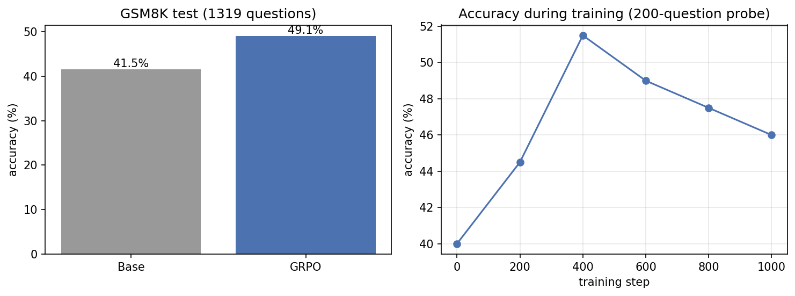
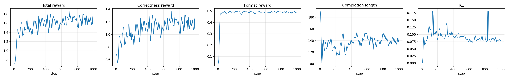
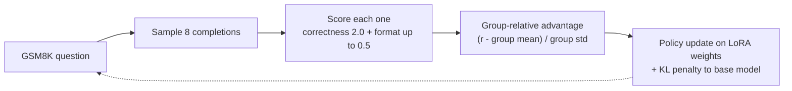

# Reasonr

Teaching a 0.5B language model to do grade-school math with reinforcement learning (GRPO), on a free Kaggle T4.

|                                          | Base Qwen2.5-0.5B-Instruct | After GRPO             |
| ---------------------------------------- | -------------------------- | ---------------------- |
| GSM8K accuracy (full test set, 1,319 q)  | 41.5%                      | **49.1%** (+7.5 pts)   |
| Follows the `<think>`/`<answer>` format  | 0%                         | **99.6%**              |
| Average answer length                    | 771 chars                  | **437 chars** (-43%)   |

GRPO fixed 227 questions the base model got wrong and broke 128 it got right. McNemar test: z = 5.25, p < 0.001.

<!-- TODO: record the demo (scrub the slider on Q1 and Q2) and save as assets/demo.gif, then uncomment -->
<!--  -->

**Live demo:** coming soon <!-- TODO: replace with the Vercel URL -->. Compare base and trained answers side by side (including the questions GRPO broke), or drag a slider across 1,000 training steps and watch answers change.

## Before / after

From `results/eval_outputs.csv`. Same prompt, greedy decoding, 512 token budget for both models.

> Cody and Trevor had 12 sandwiches. Cody ate a third of the sandwiches, and Trevor ate a quarter of the sandwiches. How many sandwiches are left?
>
> **Correct answer: 5**

**Base model** (943 chars, trimmed). Answers **17**, wrong:

```text
1. Calculate how many sandwiches Cody ate.
   - Cody ate a third of the total sandwiches: \( \frac{1}{3} \times 12 = 4 \) sandwiches.

2. Calculate how many sandwiches Trevor ate.
   - Trevor ate a quarter of the total sandwiches: \( \frac{1}{4} \times 12 = 3 \) sandwiches.

[...]

   Therefore, the remaining sandwiches are:
   - Remaining sandwiches for Cody: \( 12 - 4 = 8 \)
   - Remaining sandwiches for Trevor: \( 12 - 3 = 9 \)

4. Add the remaining sandwiches for both Cody and Trevor to get the total number of sandwiches left.
   - Total remaining sandwiches: \( 8 + 9 = 17 \)

Thus, the final answer is 17 sandwiches.
```

**After GRPO** (151 chars, full output). Answers **5**, correct:

```text
<think>
Cody ate 12 / 3 = 4 sandwiches.
Trevor ate 12 / 4 = 3 sandwiches.
So, there are 12 - (4 + 3) = 5 sandwiches left.
</think>
<answer>
5
</answer>
```

The base model gets both sub-steps right and then loses the plot while combining them. The trained model does the same arithmetic in three lines and stops.

## Results



*Left: full GSM8K test set, base vs GRPO. Right: accuracy on a 200-question probe, measured every 200 training steps.*



*Total reward, the two reward components, completion length (tokens) and KL to the base model over 1,000 steps (rolling mean of 3 log points).*

## How GRPO works

GRPO (Group Relative Policy Optimization, from the DeepSeekMath paper) is PPO without the value model. For each question the model samples a group of answers, here 8. Each answer gets a reward, and its advantage is how much better or worse it scored than the rest of its group: `(r - mean) / std`. The update raises the probability of above-average answers and lowers below-average ones, with a KL penalty that keeps the model close to where it started. No critic network and no labels on reasoning steps, just a function that scores the final output.

The catch: if all 8 answers get the same reward, every advantage is 0 and that question contributes nothing. That bit me on the first run (see below).



## Setup

| | |
| --- | --- |
| Base model | [Qwen/Qwen2.5-0.5B-Instruct](https://huggingface.co/Qwen/Qwen2.5-0.5B-Instruct) |
| Method | GRPO with TRL's `GRPOTrainer`, LoRA adapter via PEFT |
| LoRA | r = 32, alpha = 64, dropout 0.05, on q/k/v/o and gate/up/down projections |
| Training data | GSM8K train split (7,473 questions). 4 questions per step x 1,000 steps, about half an epoch |
| Group size | 8 completions per question (32 completions per step) |
| Learning rate | 5e-5, cosine schedule, 30 warmup steps |
| KL coefficient (beta) | 0.04 |
| Sampling during training | temperature 0.9, max 256 new tokens |
| Rewards | **Correctness:** 2.0 if the extracted number matches the gold answer. **Format:** 0.125 for each of `<think>`, `</think>`, `<answer>`, `</answer>` that appears exactly once (max 0.5) |
| Answer extraction | number inside `<answer>`, else inside `\boxed{}`, else the last number in the text; commas stripped |
| Precision | fp16 (the T4 has no bf16) |
| Hardware | 1x NVIDIA T4 (16 GB), free Kaggle tier |
| Time | ~22 s/step, 6.4 h of training, ~7 h end to end including evals |
| Evaluation | full GSM8K test set (1,319), zero-shot, greedy, 512 new tokens, same prompt for base and trained model |

## What I learned

**1. A reward the model never earns gives you nothing to learn from.** On my first run every reward was exactly 0 and the loss sat at 0. The 0.5B model never produced `<answer>` tags, and my extraction only looked inside them, so even correct answers scored 0. GRPO learns from differences *within* a group, so a group of 8 zeros has zero advantage and zero gradient. Two changes fixed it: lenient extraction (fall back to `\boxed{}`, then the last number) so correct answers get credit before the model learns the format, and a partial-credit format reward (0.125 per tag) so there's a gradient toward the format from step one instead of an all-or-nothing cliff. TRL logs `frac_reward_zero_std`, the share of groups with no reward variance. I now check it in the first few steps of every run. Even in the final run it averaged about 0.3, so roughly a third of the questions in each batch taught the model nothing.

**2. Small models listen to the user turn, not the system prompt.** The format instruction was in the system prompt and the model ignored it. Repeating it at the end of the user message took format compliance from 0% to 93% in the 250-step run. Cheap fix, big effect.

**3. Measure on enough data to believe the result.** v1 (250 steps, lr 2e-5) gained 6 points on a 200-question subset. With 200 questions the standard error is about 3.5 points, so that wasn't convincing. v2 (1,000 steps, lr 5e-5) was evaluated on the full 1,319-question test set with a paired McNemar test. The gain was +7.5 points, p < 0.001. The paired test is the right one here because both models answer the same questions: what matters is that it fixed 227 and broke 128, not just the net difference.

**4. Training longer wasn't the lever.** Probe accuracy peaked at step 400 (51.5%) and drifted down to 46% by step 1,000, while the training reward flattened out after about 400 steps. The KL curve has spikes (around steps 135 and 835) where the policy jumped away from the base model without the reward improving. My read is that the model hit what it could get from this setup around step 400, and the rest of the run mostly moved it around. Next time I'd hold out a validation slice of the *train* split, keep the best checkpoint by that, and stop around 400 to 500 steps.

## Limitations

- **Small model.** 0.5B parameters. 49% on GSM8K is far below larger models. The interesting part here is the before/after delta and the process, not the absolute number.
- **My eval setup, not the official one.** Zero-shot, greedy, 512 new tokens, my own prompt, and lenient answer extraction. These numbers are not directly comparable to Qwen's officially reported GSM8K scores, which use a different prompting and evaluation setup. Lenient extraction also flatters the trained model a bit. The base model doesn't use `<answer>` tags, so it's graded by the last number in its text, and sometimes that isn't its answer ("Sam would have to spend $60 to make 4 liters" gets read as 4). I hand-checked the fixed questions where the gold answer appears in the base model's final sentence: 28 of the 227 are base answers that were actually right but misgraded. GRPO's tagged answers don't have this problem (0 of the 128 broken ones). Counting those 28 as correct, base is about 43.7% and the gain is about +5.4 pts (199 fixed vs 128 broken, McNemar z = 3.9, still p < 0.001). That's a lower bound on the misgrading, since my check only looked at final sentences.
- **Final checkpoint, not best.** The reported numbers are from step 1,000, not the best probe step (400). The probe questions are the first 200 of the shuffled test set, so picking a checkpoint by them would have been selecting on test data. I used them only for monitoring.
- **Noisy probe.** 200 questions means roughly ±3.5 points of noise per probe point. The downward trend after step 400 is consistent across four checkpoints, so I trust the direction more than the exact size. The step-1000 probe (46%) is also below the full-test result (49.1%) for the same model, which shows how noisy the subset is.
- **One run, one seed.** No variance estimate across seeds.
- **Only the final number is rewarded.** Reasoning isn't graded, so a wrong chain of thought that lands on the right number still gets full credit.

## Reproduce

1. On Kaggle: **Create > New Notebook > File > Import Notebook** and upload [`notebooks/grpo_gsm8k_v2.ipynb`](notebooks/grpo_gsm8k_v2.ipynb).
2. In the notebook settings, set **Accelerator: GPU T4 x2** (the notebook uses one) and turn **Internet on**.
3. **Save Version > Save & Run All (Commit)**. It runs in the background, so you can close the tab. Takes about 7 hours.
4. When it finishes, download `grpo_results.zip` from the Output tab. It contains everything in `results/` plus the LoRA adapter.

For a quick smoke test first, set `MAX_STEPS = 20` and `EVAL_N = 100` in the config cell.

To run the demo locally:

```bash
cd demo
npm install
npm run dev   # http://localhost:3000
```

## Repo layout

```
notebooks/   training + eval notebook (Kaggle)
results/     metrics, plots, per-question eval outputs, training logs, demo samples
demo/        "Watch it learn" site (Next.js + Tailwind, static export)
```

`results/final_adapter/` (the LoRA weights, 68 MB) is not in the repo. It will be on Hugging Face. <!-- TODO: add HF link -->

| File | What's in it |
| --- | --- |
| `results/results.json` | headline accuracy, format rate and length for base and GRPO |
| `results/eval_outputs.csv` | question, gold answer and both models' full outputs for all 1,319 test questions |
| `results/train_log.csv` | TRL training log every 5 steps (rewards, KL, length, ...) |
| `results/probe_log.json` | probe accuracy every 200 steps |
| `results/demo_samples.json` | 8 test questions answered at every 100th step, used by the demo |
